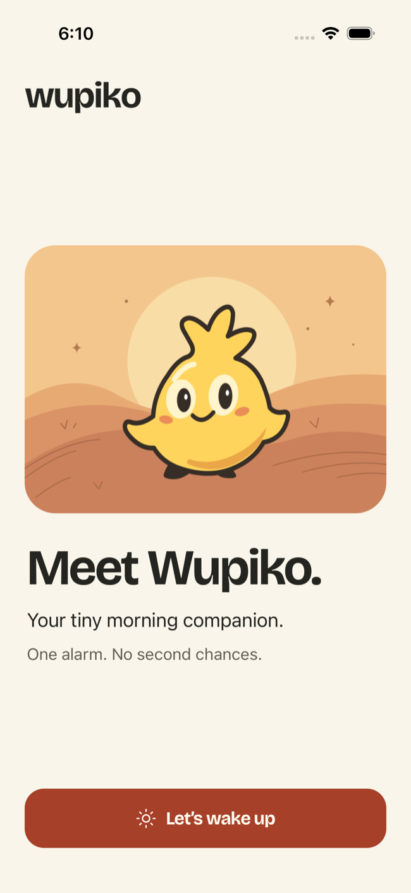
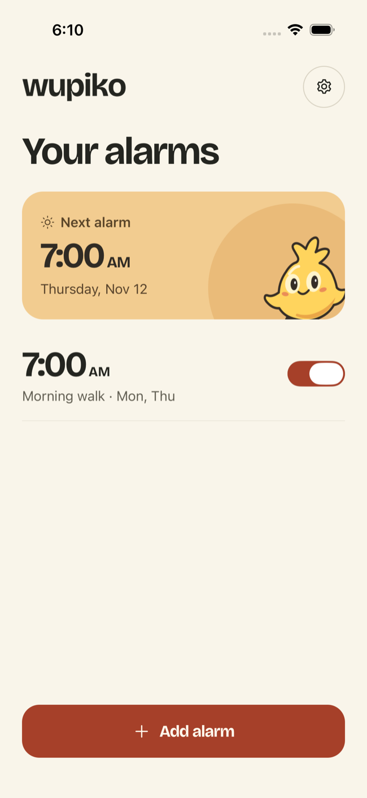

<p align="center"></p>

# Wupiko

**One alarm. No second chances.**

An offline alarm clock for iPhone and Android. Choose a time, a sound and optional repeating days. When it rings, press Stop. Wupiko keeps your alarms on your device.

<p align="center">
  
  
</p>

## QA builds

The [private QA release](https://github.com/jouleka/Wupiko/releases/tag/v1.0.0-qa.1) includes an arm64 Android APK and an iOS Simulator app. Install the APK on an Android 8+ arm64 device, or unzip the simulator build and drag the app onto a running iOS 26+ Simulator.

## Run locally

Use Node 22.13+ in the 22.x line, npm, and a native development build. Expo Go cannot host Wupiko's Swift and Kotlin modules. For iOS use a Mac with an AlarmKit-capable Xcode SDK, CocoaPods and an iOS 26+ simulator or device. For Android install Android Studio, JDK 17+, Android SDK Platform 37, build-tools 37.0.0 and the NDK version required by React Native. Set `ANDROID_HOME` to the SDK directory.

```sh
npm ci
npm run ios
# or
npm run android
```

The first build generates the native app projects. Subsequent JS-only edits load through Metro. Relaunch the development server with `npm start`. Rebuild after native code changes. After changing app config, regenerate the projects with `npx expo prebuild --clean`. Keep durable native changes in the local module or app config.

To exercise delivery without a development server, build a bundled app:

```sh
npx expo run:ios --configuration Release
npx expo run:android --variant release
```

Local Android release builds use the generated project's signing configuration. The [Android QA build](.github/workflows/android-qa.yml) workflow also produces a downloadable arm64 APK when a GitHub Actions runner is available. Store distribution requires the owner's production signing credentials.

## How delivery works

React Native and Expo Router handle the screens. A local Expo module owns alarm records, scheduling, recurrence, permission checks and dismissal. JS asks the native engine for a snapshot after edits, on native state changes and when the app returns to the foreground. SQLite stores only appearance, onboarding and alarm creation preferences. No network service participates in scheduling.

- **iOS 26+** uses AlarmKit's local-time schedules and system alert. The system controls lock-screen presentation and haptics. Earlier iOS versions are outside this app's deployment target. [iOS implementation and sources](docs/ios.md)
- **Android 8+** uses AlarmManager alarm-clock registrations, a native receiver, foreground audio service and lock-screen activity where permitted. Access changes, force-stop and vendor power policies affect delivery. [Android implementation and sources](docs/android.md)
- **Brand** assets, type licensing, colours and mascot usage are documented in the [brand guide](docs/brand.md).

## Verification

```sh
npm run typecheck
npm run lint
npm test
swiftc modules/wupiko-alarm/ios/AlarmOccurrence.swift tests/ios/main.swift -o /tmp/wupiko-ios-recurrence
/tmp/wupiko-ios-recurrence
```

The TypeScript suite exercises state transitions, native failures, dismissal and persistence. Native recurrence tests exercise local calendar rules at the scheduling boundary. On Android, run `./gradlew :wupiko-alarm:testDebugUnitTest` from the generated `android` directory. With an API 33+ emulator attached, `./gradlew :wupiko-alarm:connectedDebugAndroidTest` also exercises the native alarm state transitions. Use the [device checklist](docs/device-checklist.md) and [validation record](docs/validation.md) to distinguish verified behavior from release checks still outstanding.
